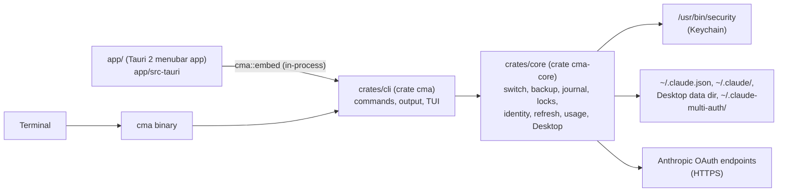

# Architecture

How claude-multi-auth is put together, for people changing it. What each
command does for a user is in [usage.md](usage.md); the `--json`
contract is in [json-api.md](json-api.md). The module docs at the top of each
file in `crates/core/src/` are the detailed, authoritative description; this
page is the map.

## Crates

- **`crates/core` (`cma-core`)** holds all logic: the registry, the secret
  store, locking, the journal, backups, the CLI and Desktop targets, login,
  token identity, refresh and usage. It never prompts and never prints.
- **`crates/cli` (`cma`)** is the command layer: argument parsing
  (`src/lib.rs`), one module per command (`src/commands/`), the output layer
  (`src/output.rs`: human text or one JSON document, exit codes), the
  `list --live` view (`src/tui.rs`) and the external dependencies a command
  talks to (`src/deps.rs`).
- **`crates/cli/src/embed.rs`** is the menubar app's entry point. The app
  links the `cma` crate and runs a command in-process exactly as
  `cma <cmd> --json` would, except that a consent question goes to the app's
  native dialog instead of a terminal. The bundled `cma` binary inside the
  app is the same crate, for terminal use.
- **`app/`** is the Tauri 2 menubar app: the webview UI in `app/src/`, the
  Rust side (tray menu, commands, login launcher) in `app/src-tauri/src/`.

## State and where it lives

| What | Where |
|---|---|
| Claude Code's live login | Keychain item `Claude Code-credentials` (a hashed variant with `CLAUDE_CONFIG_DIR`; see `crates/core/src/cli_target.rs`), and `oauthAccount` in `~/.claude.json` |
| Stored accounts (CLI credentials) | Keychain service `claude-multi-auth`, one item per account |
| Registry: accounts, active targets, settings, fingerprints | `~/.claude-multi-auth/registry.json` (`crates/core/src/registry.rs`) |
| Backups | metadata in `~/.claude-multi-auth/backups/<id>/manifest.json`; secret values in Keychain service `claude-multi-auth-backup` |
| Operation journal | `~/.claude-multi-auth/op.journal` |
| Locks | `~/.claude-multi-auth/.lock`, `~/.claude-multi-auth/locks/<hash>.lock`, and Claude Code's own `.storage-write` |
| Claude Desktop's live login | keys in `config.json` and storage files under `~/Library/Application Support/Claude` |
| Desktop logins that are not live | files in `~/.claude-multi-auth/desktop/<account uuid>/files/` (with `snapshot.json`); `config.json` values and secret files in Keychain service `claude-multi-auth-desktop` |

Paths come from `crates/core/src/paths.rs`. `~/.claude-multi-auth` can be
moved with `CMA_HOME` only when `CMA_ALLOW_HOME_OVERRIDE=1` is also set (used
by the tests).

## How a mutation is made safe

Every command that changes state follows the same shape:

1. **Session start** (`crates/core/src/sync.rs`, `begin`): take the cma lock,
   roll back any interrupted operation from its journal, load the registry,
   and sync the live Claude Code login (a token Claude Code refreshed is
   stored under its account first). Mutating CLI-target code can only run
   inside the session this returns.
2. **Backup** (`crates/core/src/backup.rs`): before a value is overwritten,
   its pre-image is saved. The manifest is a write-ahead log: each entry
   (including the name of its Keychain backup item) and the hash of every
   value cma is about to write are saved before the write. Secret pre-images
   go only to the Keychain, never to disk.
3. **Journal** (`crates/core/src/journal.rs`): `op.journal` is written before
   the first change, updated after each step and deleted on success.
4. **Writes, read back.** Every Keychain write goes through
   `/usr/bin/security` and is verified by reading the item back
   (`crates/core/src/secret.rs`). File writes are atomic replacements
   (`crates/core/src/fsutil.rs`).
5. **Post-check, then commit.** The result is checked (for the CLI target,
   by the credential fingerprint), the registry is updated, and the journal
   is deleted.

**Rollback.** A failure after the journal began, or a crash that leaves it
behind, is rolled back from the backup, but only over values that still
equal what cma wrote. A value another program changed in the meantime is
never overwritten: the state is then *uncertain* (exit 2), the journal stays
and blocks new operations until it is resolved (`cma resolve-journal`).
`cma restore <id>` uses the same backup and the same check.

**Identity.** Which account a token belongs to always comes from the token:
the fingerprint map in the registry, or Anthropic's
`/api/oauth/profile` endpoint while the token is unexpired. Every source
that answers must agree; otherwise nothing is stored. `oauthAccount` in
`~/.claude.json` is never used as identity (`crates/core/src/identity.rs`).

## The CLI target

`crates/core/src/switch.rs`. Within the session above: take the target
account's lock and re-read its stored credential; confirm when the live
login is one cma does not store, or when `claude` sessions are running;
back up and journal; then, inside Claude Code's `.storage-write` lock,
read-modify-write the live item replacing only `claudeAiOauth` (every other
key, such as `mcpOAuth`, keeps its exact bytes); replace only `oauthAccount`
in `~/.claude.json`; post-check; update the registry.

The read-modify-write happens only if the live credential is still the one
sync stored. If a running session refreshed it in between, the switch fails
with `concurrent_write` before anything is written, and a retry succeeds.

cma never creates `~/.claude` or `~/.claude.json`; when either is missing
it fails before writing anything.

## The Desktop target

`crates/core/src/desktop_target.rs`, with process control in
`crates/core/src/desktop_app.rs`.

What counts as Desktop's login is shipped data:
[`crates/core/data/desktop_identity.json`](../crates/core/data/desktop_identity.json)
lists the `config.json` keys and the storage paths (a SQLite file takes its
sidecars with it). Everything else in Desktop's data directory stays where
it is.

- **Storage files are moved, not copied.** For an account that is not the
  live Desktop login, its files live in
  `~/.claude-multi-auth/desktop/<account uuid>/files/` (0700), listed with
  hashes in `snapshot.json`. While an account is live its directory holds
  no files: the live directory is the only copy, so every switch captures
  the newest state again (rotated tokens included).
- **Config values go to the Keychain**, service `claude-multi-auth-desktop`,
  account `<account uuid>/<key>`, as do secret files such as Desktop's
  `config.json.journal`.
- **A switch**: the caller quits Desktop (with consent; never forced) →
  preflight (the target's snapshot is complete, `config.json` exists,
  Desktop's directory and cma's are on one volume) → backup and journal →
  move the live login into its owner's snapshot (or, for a login cma does
  not store, into the backup after consent) → move the target's files in
  place → merge the target's keys into `config.json` (every other key kept)
  → session follow → post-check → registry → start Desktop again.
- **Desktop must stay quit.** Before every write step a guard checks that
  Desktop is still not running. If it appeared (for example an auto-update
  relaunch), the operation stops; its rollback waits until Desktop is quit
  again, because cma never writes while Desktop runs.
- **Session follow** (`crates/core/src/sessions.rs`, layout data in
  [`crates/core/data/desktop_layout.json`](../crates/core/data/desktop_layout.json)):
  when on, a Desktop switch also moves the previous account's local
  sessions into the new account's folders. The moves are recorded in the
  backup, so rollback and `cma restore` move them back.
- **`switch --both`** checks everything the Desktop half needs before the
  CLI half changes, and puts Claude Code back if the Desktop half still
  fails.

## Locks

From `crates/core/src/lock.rs`. Always taken in this order and released in
reverse:

1. **cma lock**, `~/.claude-multi-auth/.lock`: one mutating operation at a
   time.
2. **Per-account lock**, `~/.claude-multi-auth/locks/<hash>.lock`, at most
   one per thread. It covers every read of a stored credential that will use
   or replace its refresh token. A token refresh holds it across read, POST
   and write without holding the cma lock, so network calls never block
   other commands.
3. **Claude Code's `.storage-write` lock**: last and briefest. It is held
   only around the read-check-write of the live `Claude Code-credentials`
   item, never across a network call, and never across a Keychain read that
   could show a prompt (the item is read once before the lock is taken).
   Claude Code gives up waiting for it after a few seconds, so holding it
   long is harmful.

Debug builds assert this order at runtime.

## Token refresh and usage

`crates/core/src/refresh.rs` and `crates/core/src/usage.rs`.

- Refreshing rotates the refresh token: the old one stops working at once.
  So a refresh runs under the account's lock and keeps a pre-refresh copy
  and then a post-refresh copy of the credential in
  `claude-multi-auth-backup`, so a crash between the POST and the store
  never loses the only valid grant. The new token's identity is verified
  before it is stored.
- cma never refreshes the account Claude Code is using now, nor one that was
  active within `refresh_grace_secs` (default 300 s), since sessions may
  still be running on its token.
- Usage is fetched per account with that account's own token, a few
  accounts at a time. No lock is held during the usage request; the cma lock
  is taken once at the end to write the results.
- All HTTP goes through one client (`crates/core/src/http.rs`): HTTPS only,
  no redirects, 5 s timeout, nothing logged. Code above it uses a trait, so
  tests never reach the network.

## Login

`crates/core/src/login.rs`. `cma login` runs `claude auth login` with a
cleared environment and `CLAUDE_CONFIG_DIR` pointing at a fresh private
directory under `~/.claude-multi-auth/`, so Claude Code writes the new login
into a separate, hashed Keychain item and the live login is untouched. cma
then identifies the new credential by its token, stores it, and deletes the
temporary item and directory. Leftovers of an interrupted login are swept by
the next `cma login`.
